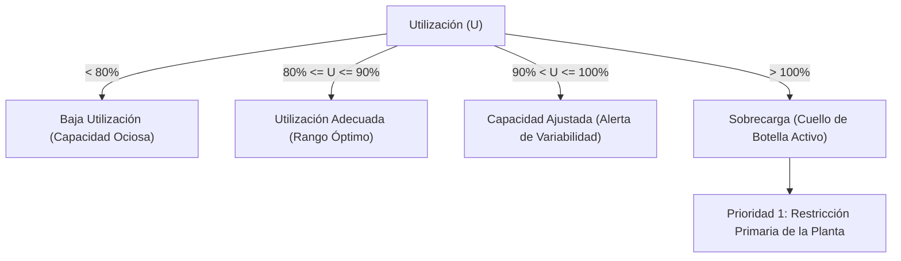
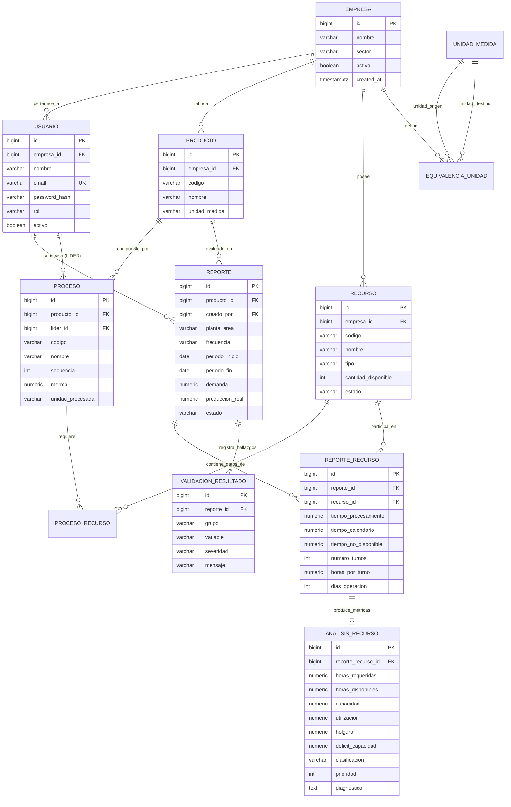
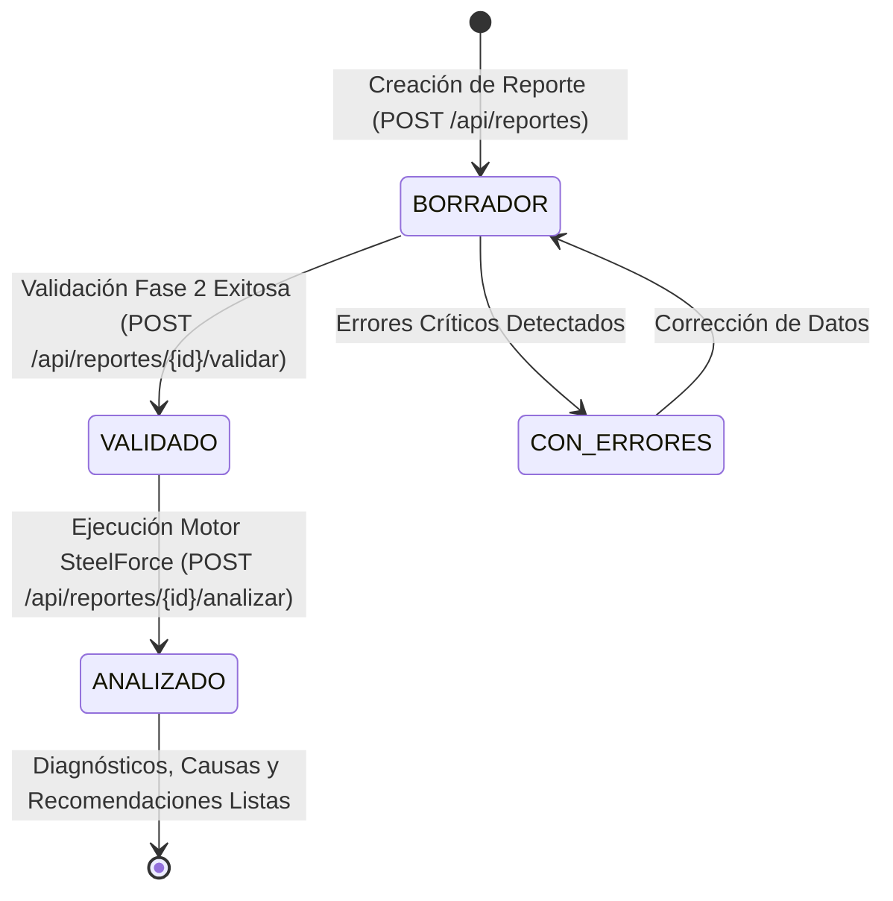
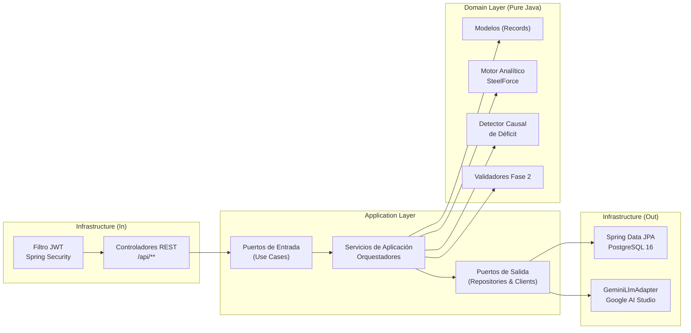
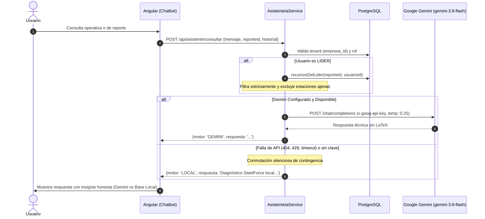

# Indux — Plataforma Empresarial SteelForce

**Plataforma web empresarial orientada al diagnóstico de capacidad instalada, detección de cuellos de botella y optimización de procesos operativos industriales bajo la metodología SteelForce.**


---

## Índice

1. [Visión General del Proyecto](#1-visión-general-del-proyecto)
2. [Estructura del Monorepo](#2-estructura-del-monorepo)
3. [Metodología SteelForce y ODS 9](#3-metodología-steelforce-y-ods-9)
4. [Diseño y Arquitectura de la Base de Datos](#4-diseño-y-arquitectura-de-la-base-de-datos)
   - [Diagrama Entidad-Relación (Mermaid)](#41-diagrama-entidad-relación-er)
   - [Flujo del Ciclo de Vida del Reporte](#42-flujo-del-ciclo-de-vida-del-reporte-state-diagram)
   - [Diccionario de Tablas y Restricciones](#43-diccionario-de-tablas-y-restricciones)
5. [Arquitectura del Sistema](#5-arquitectura-del-sistema)
   - [Arquitectura Hexagonal del Backend](#51-backend-arquitectura-hexagonal)
   - [Arquitectura Frontend (Angular 21 + Signals)](#52-frontend-angular-21--signals)
6. [Asistente Inteligente SteelForce (Google Gemini + Contingencia)](#6-asistente-inteligente-steelforce)
7. [Matriz de Seguridad y Roles (RBAC)](#7-matriz-de-seguridad-y-roles-rbac)
8. [Puesta en Marcha Rápida](#8-puesta-en-marcha-rápida)
9. [Variables de Entorno (.env)](#9-variables-de-entorno-env)
10. [Batería de Pruebas Automatizadas](#10-batería-de-pruebas-automatizadas)
11. [Documentación de API y Colección Postman](#11-documentación-de-api-y-colección-postman)

---

## 1. Visión General del Proyecto

**Indux** es una plataforma SaaS industrial concebida para balancear cargas operativas, detectar restricciones primarias (cuellos de botella) y sugerir acciones de mejora en plantas de producción, manufactura y operaciones logísticas. 

Alineada con el **ODS 9 (Industria, Innovación e Infraestructura)**, permite simular escenarios predictivos de capacidad mediante modelos matemáticos rigurosos y ofrece asistencia en lenguaje natural impulsada por **Google Gemini** con respaldo determinístico local.

---

## 2. Estructura del Monorepo

El proyecto está organizado como un monorepo que integra backend y frontend desacoplados:

```
Indux/
├── src/                                # Código fuente Backend (Java 21 / Spring Boot)
│   ├── main/java/com/indux/induxbackend/
│   │   ├── domain/                     # Núcleo de lógica pura (Models, Service, Validaciones)
│   │   ├── application/                # Casos de uso y puertos (In/Out)
│   │   └── infrastructure/             # Adaptadores Web REST, Persistencia JPA y LLM
│   └── main/resources/
│       ├── db/migration/               # Migraciones Flyway de base de datos (V1..V4)
│       └── application.yml             # Configuración Spring Boot
│
├── Indux-Fronted/                      # Código fuente Frontend (Angular 21)
│   ├── src/app/
│   │   ├── core/                       # Servicios API, interceptor JWT, modelos, constantes
│   │   ├── layouts/                    # AppLayout (Sidebar, Navbar) y PublicLayout
│   │   ├── pages/                      # Componentes Standalone (Dashboard, Reportes, Chatbot, etc.)
│   │   └── services/                   # Servicios reactivos con Signals
│   ├── package.json                    # Dependencias frontend (Tailwind CSS 4, Lucide Icons)
│   └── angular.json                    # Configuración de compilación Angular
│
├── .env.example                        # Plantilla de variables de entorno (segura, sin credenciales)
├── docker-compose.yml                  # Orquestación de base de datos PostgreSQL 16
├── pom.xml                             # Configuración Maven del backend
├── Indux_Plataforma_Postman_Collection.json # Suite completa de pruebas de integración Postman
└── generar_postman_collection.py       # Script generador de la suite Postman
```

---

## 3. Metodología SteelForce y ODS 9

### Fórmulas Matemáticas Centrales:
1. **Horas Requeridas ($H_{req}$):**
   $$H_{req} = \text{Demanda} \times \text{Tiempo Estándar de Procesamiento} \times \left(\frac{1}{1 - \text{Merma}}\right)$$
2. **Horas Disponibles ($H_{disp}$):**
   $$H_{disp} = \text{Turnos} \times \frac{\text{Horas}}{\text{Turno}} \times \text{Días Operación} \times \text{Cantidad de Recursos} - \text{Tiempo No Disponible}$$
3. **Índice de Utilización ($U$):**
   $$U = \left(\frac{H_{req}}{H_{disp}}\right) \times 100\%$$
4. **Holgura Operativa ($H$):**
   $$H = H_{disp} - H_{req}$$
5. **Déficit de Capacidad:**
   $$\text{Déficit} = \max(0, H_{req} - H_{disp})$$

### Clasificación de Recursos:


---

## 4. Diseño y Arquitectura de la Base de Datos

La base de datos utiliza **PostgreSQL 16** gestionada con migraciones evolutivas e inmutables mediante **Flyway (V1 a V4)**.

### 4.1. Diagrama Entidad-Relación (ER)



### 4.2. Flujo del Ciclo de Vida del Reporte (State Diagram)



### 4.3. Diccionario de Tablas y Restricciones
- **`empresa`:** Multi-tenancy isolation. Sector industrial categórico con advertencias no bloqueantes.
- **`usuario`:** Cuentas con roles `ADMIN`, `LIDER`, `ANALISTA`. Restricción `CHECK (rol IN ('ADMIN', 'LIDER', 'ANALISTA'))`. Contraseñas protegidas mediante BCrypt con sal aleatoria.
- **`producto`:** Catálogo de productos. Restricción única compuesta `(empresa_id, codigo)`.
- **`proceso`:** Etapas de manufactura. Ordenadas por `secuencia > 0` única por producto. Admite porcentaje de merma para cálculo de masa/volumen bruto requerido.
- **`recurso`:** Estaciones, hornos, tornos y líneas. Desacopladas a nivel de empresa en `V3` para permitir modelar **recursos compartidos** entre múltiples líneas productivas (`proceso_recurso`).
- **`reporte`:** Contenedor de análisis periódico. Estados controlados: `BORRADOR`, `VALIDADO`, `CON_ERRORES`, `ANALIZADO`.
- **`reporte_recurso`:** Parámetros operativos concretos en el periodo evaluado (turnos, horas/turno, días, demoras).
- **`analisis_recurso`:** Indicadores consolidados post-análisis. Almacena histórico inmutable para gráficos de tendencias y comparativas temporales.
- **`validacion_resultado`:** Errores críticos (impiden analizar) vs Advertencias (alertas de calidad de datos).

---

## 5. Arquitectura del Sistema

### 5.1. Backend: Arquitectura Hexagonal



### 5.2. Frontend: Angular 21 + Signals

- **Componentes Standalone:** Cero NgModules. Menor tamaño de empaquetado y carga perezosa (`loadComponent`) en todas las rutas.
- **Reactividad con Signals:** Manejo de estado predecible y eficiente con `signal()`, `computed()` y `effect()`.
- **Diseño SaaS con Tailwind CSS 4:** Paleta profesional empresarial, iconografía unificada con Lucide Icons (cero emojis), animaciones fluidas y soporte responsivo completo.
- **Seguridad en Cliente:** `AuthInterceptor` inyecta automáticamente el token Bearer en peticiones salientes y captura errores 401 para expiración de sesión.

---

## 6. Asistente Inteligente SteelForce

El asistente conversacional (`/app/chatbot`) interactúa con el backend en `/api/asistente`:



---

## 7. Matriz de Seguridad y Roles (RBAC)

| Módulo / Recurso | ADMIN | ANALISTA | LIDER |
| :--- | :---: | :---: | :---: |
| Autenticación (`/api/auth/login`) | Público | Público | Público |
| Empresas (`/api/empresas/**`) | Total (CRUD) | Denegado (403) | Denegado (403) |
| Usuarios (`/api/usuarios/**`) | Total (CRUD) | Denegado (403) | Denegado (403) |
| Catálogo de Productos y Procesos | Total | CRUD (Su Empresa) | Solo Lectura |
| Recursos y Estaciones | Total | CRUD (Su Empresa) | Solo Lectura |
| Reportes (Crear / Validar / Analizar) | Total | Total (Su Empresa) | Solo Lectura |
| Asistente SteelForce | Global | Su Empresa | Filtrado a sus Estaciones |

---

## 8. Puesta en Marcha Rápida

### Paso 1: Clonar el Repositorio Monorepo
```bash
git clone https://github.com/JuanGale-20/Indux.git
cd Indux
```

### Paso 2: Configurar Variables de Entorno del Backend
```powershell
Copy-Item .env.example .env
```

### Paso 3: Iniciar PostgreSQL con Docker
```bash
docker compose up -d
```

### Paso 4: Iniciar el Backend (Spring Boot)
En Windows:
```powershell
.\run-backend.cmd
```
O usando Maven Wrapper:
```bash
./mvnw spring-boot:run
```
*El backend compilará e iniciará en `http://localhost:8080` aplicando automáticamente las migraciones Flyway.*

### Paso 5: Iniciar el Frontend (Angular)
En otra terminal:
```bash
cd Indux-Fronted
npm install
npm start
```
*El frontend estará disponible de inmediato en `http://localhost:4200`.*

---

## 9. Variables de Entorno (.env)

| Variable | Descripción | Valor de Ejemplo |
| :--- | :--- | :--- |
| `INDUX_DB_URL` | URL JDBC de conexión a PostgreSQL | `jdbc:postgresql://localhost:5432/indux` |
| `INDUX_DB_USERNAME` | Usuario de base de datos | `indux_user` |
| `INDUX_DB_PASSWORD` | Contraseña de base de datos | `<tu_contrasena>` |
| `INDUX_JWT_SECRET` | Secreto HMAC-SHA256 en Base64 ($\ge 256$ bits) | `<clave_base64>` |
| `INDUX_ADMIN_EMAIL` | Correo del administrador inicial | `admin@indux.com` |
| `INDUX_ADMIN_PASSWORD` | Contraseña del administrador inicial | `<tu_clave_segura>` |
| `INDUX_CORS_ORIGEN` | Origen frontend permitido | `http://localhost:4200` |
| `SWAGGER_ENABLED` | Activar Swagger UI y OpenAPI docs | `true` |
| `GEMINI_API_KEY` | Clave API de Google AI Studio (opcional) | `AIzaSy...` |
| `GEMINI_MODEL` | Modelo de Gemini para el asistente | `gemini-3.8-flash` |
| `GEMINI_BASE_URL` | Endpoint base oficial de Google AI Studio | `https://generativelanguage.googleapis.com/v1beta/openai` |
| `INDUX_LLM_TIMEOUT` | Timeout máximo en segundos | `15` |

---

## 10. Batería de Pruebas Automatizadas

La plataforma cuenta con pruebas unitarias, de integración y de seguridad que garantizan cero regresiones:

- **Backend (178 pruebas pasando al 100%):**
  ```powershell
  .\mvnw.cmd test
  ```
- **Frontend (30 pruebas Vitest pasando al 100%):**
  ```bash
  cd Indux-Fronted
  npm test
  ```
- **Compilación de Producción:**
  ```bash
  cd Indux-Fronted
  npm run build
  ```

---

## 11. Documentación de API y Colección Postman

- **Swagger UI Interactivo:** [http://localhost:8080/swagger-ui.html](http://localhost:8080/swagger-ui.html)
- **OpenAPI v3 JSON:** [http://localhost:8080/v3/api-docs](http://localhost:8080/v3/api-docs)
- **Colección Postman:** [`Indux_Plataforma_Postman_Collection.json`](./Indux_Plataforma_Postman_Collection.json) incluye todas las peticiones con autenticación automática, variables de entorno y validación de respuestas.

---

## Licencia

Distribuido bajo la Licencia MIT. Consulta el archivo `LICENSE` para más información.